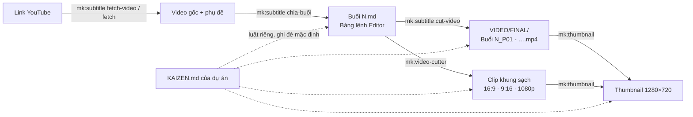

# mk-studio

Bộ skill **nội dung, video và đóng gói giá trị** cho AI coding agent (Claude Code, omp, Codex và mọi agent đọc chuẩn Agent Skills). Mỗi skill đứng độc lập, cài riêng theo nhu cầu; dùng chung thì nối thành một dây chuyền từ bài giảng thô tới video con có phụ đề và thumbnail.

Bộ skill kỹ thuật & lập trình đi kèm là **[mk-lab](https://github.com/mzavn/mk-lab)** (Spec-Driven Development).

---

## Danh mục skill

| Skill | Gọi | Nói tự nhiên | Làm gì |
|---|---|---|---|
| **`mk-star`** | `/mk:star` | *"viết nhật ký ngày"*, *"giải quyết vấn đề"*, *"luyện case 05"* | Hệ nhật ký STAR 5 loại: biến cảm xúc, vấn đề, thành công thành quyết định, kế hoạch và tài sản đóng gói. Lưu hoàn toàn trên máy (`~/nhat-ky-star/`). |
| **`mk-exec-review`** | `/mk:exec-review <file>` | *"phản biện bài <đường dẫn>"*, *"đọc bài như CEO"*, *"soát bài"* | Hội đồng C-level phản biện bài viết theo chân dung khách hàng, bóc giọng văn AI, chuẩn hoá thuật ngữ, tối ưu SEO/GEO/AEO; chỉ sửa mã bạn duyệt. |
| **`mk-subtitle`** | `/mk:subtitle <file, video hoặc link YouTube>` | *"lấy phụ đề youtube"*, *"cắt ừ à"*, *"chia file con"*, *"cắt chỗ nói lại"*, *"in phụ đề vào video"* | Phụ đề cho khâu dựng: tải phụ đề/video YouTube, duyệt từ đệm, chuẩn hoá tiếng Việt, dịch tiếng Anh, chia buổi học 2–4 tiếng thành file con 20–30 phút có Bảng lệnh Editor, cắt video con, bản final cho video có kịch bản, in phụ đề vào video. |
| **`mk-video-cutter`** | `/mk:video-cutter <video>` | *"cắt video"*, *"bỏ thanh zoom"*, *"video dọc 9:16"*, *"nâng 1080p"* | Cắt clip theo Action Sheet với khung hình sạch (bỏ thanh Zoom, dải đen), đổi khung 16:9 / 9:16, lên 1080p, làm nét vừa phải, cân bằng hai tai và chuẩn âm lượng. |
| **`mk-thumbnail`** | `/mk:thumbnail <thư mục video>` | *"làm thumbnail"*, *"ảnh bìa video"*, *"thumbnail cả thư mục"* | Thumbnail YouTube cho cả chuỗi bài giảng theo một khuôn: nhãn `Buổi N · Pxx` và tiêu đề lấy từ tên file, ghép nền AI bạn tự tạo (skill viết prompt) hoặc nền bát quái vẽ sẵn, chân dung, logo. Chạy offline. |
| **`mk-kaizen`** | `/mk:kaizen` | *"ghi lại luật này"*, *"lần sau nhớ"*, *"dự án này có luật gì"* | Luật riêng của dự án trong `KAIZEN.md`: điều bạn đã sửa, yêu cầu lâu dài, quyết định đã chốt. Mọi skill mk đọc và theo; luật lặp ở nhiều dự án thành đề xuất sửa skill. |

> **Tên lệnh và quyền**
> - Slash command dùng dấu hai chấm (`/mk:subtitle`); thư mục cài và cờ `--skill` dùng gạch nối (`mk-subtitle`).
> - Tiền tố `mk:` là quy ước đặt tên của bộ skill, **không** phải plugin Claude Code tên `mk`. Cấu hình quyền trong `settings.json` thì khai báo theo tên skill, vd `Skill(mk:star)`.

---

## Dây chuyền video bài giảng



Mỗi mũi tên là một bước bạn duyệt trước khi skill ghi file; không skill nào ghi đè hay xoá file gốc.

---

## 1. mk:star — Hệ nhật ký STAR (5 loại)

Dẫn bạn viết nhật ký từng câu hỏi theo khuôn chuẩn, lưu mỗi bài thành một file Markdown trong `~/nhat-ky-star/` và theo dõi tiến độ theo cột mốc.

| Loại | Khi viết | Đầu ra |
|---|---|---|
| **I · Daily Diary** | Trong ngày hoặc cuối ngày | Cải tiến 1% mỗi ngày, một hành động cho ngày mai có giờ cụ thể. |
| **II · Problem Solving** | Gặp khó khăn, vướng mắc, thất bại | Bản đầy đủ 8 bước A–Z hoặc bản viết nhanh 4 bước (R → S → T → A). |
| **III · Packing Value** | Sau một thành công | Đóng gói kinh nghiệm thành 1 trong 8 dạng tài sản chuyển giao được. |
| **IV · Creating Future** | Trước sự kiện, dự án, cuộc gặp quan trọng | Kịch bản, tâm thế và phương án ứng phó trước khi hành động. |
| **V · Mentoring** | Trước buổi 1-1, đào tạo, coaching, bán hàng | Thấu cảm người đối diện rồi soi lại năng lực người dẫn dắt. |

- **Kho luyện tập:** 4 case giải mẫu từng bước và 28 case tình huống quản trị, đời sống.
- **Tiến độ (`progress.py`):** đếm bài trọn vẹn theo 4 cột mốc (28 / 300 / 1.000 / 10.000), nhắc việc hẹn chưa làm và kết quả đến hạn nghiệm thu.
- **Dữ liệu cá nhân:** chỉ lưu trên máy; cảnh báo khi thư mục nằm trong git; ghi file nguyên tử; từ chối ghi xuyên symlink.

---

## 2. mk:exec-review — Hội đồng C-level phản biện bài viết

Một ban cố vấn độc lập đọc bài viết tiếng Việt (Markdown) qua chân dung khách hàng mục tiêu trước khi đăng.

1. **Hội đồng theo persona:** 2–4 vai trong CEO, CFO, CMO, COO, CTO; chỉ ra dòng giữ chân người đọc, dòng làm mất niềm tin, câu hỏi còn bỏ ngỏ.
2. **Giọng văn AI:** mở bài sáo, đối lập lật ngược lặp lại, từ phô trương, câu dịch thô, lạm dụng gạch dài; giữ nguyên câu có chất giọng người thật.
3. **Thuật ngữ:** đồng nghĩa trôi dạt, vị trí dấu (hoá/hóa), viết hoa giữa câu; không gộp khái niệm tác giả cố ý tách.
4. **SEO / AEO / GEO:** khớp ý định tìm kiếm, câu trả lời 40–60 tiếng dưới tiêu đề dạng hỏi, thực thể rõ và trích dẫn được cho ChatGPT, Perplexity, AI Overviews.
5. **Ý tưởng (mã Y):** 3–5 hướng nâng bài, xếp theo mức tác động.

Phản biện chạy trong một subagent chỉ đọc, trả về bảng mã (`A` giọng AI, `T` thuật ngữ, `S` SEO/GEO, `C` hội đồng, `Y` ý tưởng). `check_report.py` kiểm cơ học báo cáo (trích dẫn có thật, không thêm số liệu, không đổi link/ảnh/HTML). Bạn duyệt mã nào (`duyệt A1 T1-T3`) agent sửa đúng mã đó; chỗ thiếu số liệu để ô `[điền: …]`, không bịa.

---

## 3. mk:subtitle — Phụ đề, chia buổi học và cắt video con

Gõ `/mk:subtitle` kèm file `.srt`, `.vtt`, `.txt`, video, hoặc link YouTube.

**Lấy nguồn**
- **Phụ đề có sẵn trên YouTube** (`fetch`): vài giây, ưu tiên bản chủ kênh, không có thì bản tự động gốc có mốc từng từ; bản dịch máy bị từ chối.
- **Video nguồn theo chuẩn khoá** (`fetch-video`): mặc định 720p30 H.264 + AAC, không ghi đè, so với video buổi trước (`--ref`) và báo `LỆCH:` khi khác độ phân giải, khung hình, codec. Chỉ tải khi bạn yêu cầu, từ đúng link bạn đưa.
- **Chỉ có file video ≤ 15 phút:** khi bạn đồng ý gửi âm thanh lên Google, Gemini qua `agy` chép lời từng cụm, mốc thời gian đo trên chính âm thanh. Không đồng ý: đăng YouTube không công khai rồi `fetch`, hoặc tự cài whisper.cpp.

**Mode phụ đề (SRT/VTT)**
1. Từ đệm "à, ừ, ờ…" và lặp từ chia ba nhóm: **A** đề xuất cắt (âm đệm giữa câu, lặp vấp trong cụm), **B** cần nghe lại (đầu câu, sau câu hỏi, sau tên riêng hay từ xưng hô), **Giữ** (lặp qua dấu câu, từ láy, tiểu từ liệt kê). Đo trên 577 chỗ đã chấm tay: A đúng khoảng 91%, Giữ khoảng 96%, chỉ khoảng 1/4 số chỗ cần bạn nghe lại. Chỉ mã bạn duyệt mới bị xoá và vào danh sách cắt cho editor.
2. Ngắt dòng theo khổ video (ngang 42 ký tự, dọc 26), cảnh báo câu đọc không kịp.
3. Chuẩn hoá tiếng Việt theo bảng thuật ngữ của dự án; dịch tiếng Anh khớp từng câu, cùng mốc.
4. Thư mục giao editor: phụ đề Việt/Anh timeline gốc và sau cắt, track `✂` tham chiếu, `cat.csv`, `BAN-GIAO.md`.

**Mode chia buổi (bài giảng 2–4 tiếng)**
1. Lọc thời gian chết: chào hỏi, thử mic đầu giờ, giải lao có quãng lặng, mất tiếng. Nghỉ tại chỗ không có quãng lặng thì không tạo đoạn CUT, chỉ ghi chú editor tỉa câu báo nghỉ.
2. Chia file con 20–30 phút theo chủ đề; vấn đáp giữ đủ `[A Hỏi]` – `[B Đáp]`, đối thoại Socrates giữ đủ ba nhịp.
3. **Bảng lệnh Editor** (🛑 CUT / 🟢 KEEP, timecode, tiêu đề, ghi chú đồ hoạ) và file bài giảng theo khuôn khoá (`split --style khoa`: mốc in đậm, mỗi lượt lời một dòng `> 🗣️`, đoạn CUT là `[!WARNING]`, mục lục `[!ABSTRACT]`).
4. **Một nguồn tên cho mọi đầu ra:** `--name "{prefix}_P{n:02} - {title}"` (hoặc tự suy từ file có sẵn trong `VIDEO/FINAL/`) đặt tên đồng bộ cho bảng Editor, phụ đề và video; `--label` đặt nhãn hiển thị.
5. **Âm thanh:** `probe-audio` đo độ to tích hợp **cả file** (`ebur128`) và lệch hai tai; chỉ khuyên `master` khi cả file dưới khoảng −24 LUFS, cảnh báo khi sát ngưỡng, và đề xuất cùng chế độ với các clip đã có của khoá.
6. **Cắt video con** (`cut-video`): từ chối kế hoạch dài hơn video trước khi cắt; mỗi clip được `ffprobe` kiểm thời lượng, hình và tiếng rồi mới mang tên thật; không ghi đè file có sẵn.

**Mode video có kịch bản (bản final):** tách cụm lời theo khoảng ngừng (lệch trung vị khoảng 0,03 giây), tìm câu đọc lại, bạn duyệt bảng CUT/KEEP, ghép một file final kèm phụ đề đã dời mốc.

**In phụ đề vào video (tuỳ chọn):** đặt chữ trong vùng an toàn của TikTok / Shorts / Reels / YouTube, tránh mặt người nói, cho xem ảnh mẫu trước khi in. Cần ffmpeg có libass.

---

## 4. mk:video-cutter — Khung hình sạch, âm thanh đều

Gõ `/mk:video-cutter <video> --sheet <action sheet>`. Phân rã bài giảng dài thành clip chuyên đề:

1. **Âm thanh:** `probe` đo cả file một lượt (độ to tích hợp + từng tai), chọn `copy` (giữ nguyên), `balance` (dual-mono khi lệch ≥ 4 dB hoặc điếc một tai) hoặc `master` (chuẩn −16 LUFS khi cả file quá nhỏ); khuyên giữ một chế độ cho cả khoá.
2. **Khung hình sạch:** tìm vùng bài giảng trong cửa sổ Zoom, bỏ thanh menu, thanh công cụ, dải đen; ảnh xem trước để duyệt; báo đoạn Zoom đổi bố cục.
3. **Khung đầu ra:** 16:9, 9:16, 1:1, 4:5 hoặc tuỳ chỉnh; `--res auto` lên đúng một bậc (720p → 1080p); cảnh báo khi ép 2K/4K từ nguồn 720p.
4. **Làm nét vừa phải (`--enhance`):** khử khối vỡ, khử nhiễu, làm nét nhẹ, không vẽ lại chữ trên bảng.
5. **Chất lượng:** không đổi khung thì giữ nguyên từng điểm ảnh; đổi khung thì nén lại ở mức cao (đo trên bài giảng thật: VMAF 97/100).
6. **Nghiệm thu:** `ffprobe` kiểm dung lượng, thời lượng, khung hình từng clip.

---

## 5. mk:thumbnail — Thumbnail YouTube theo khuôn cho cả chuỗi

Gõ `/mk:thumbnail <thư mục video>`. Skill chỉ đọc **tên file** (không mở video) và ghép ảnh theo một khuôn để cả chuỗi đồng bộ.

```
names → (prompt → bạn tạo ảnh nền vào nen/) → plan → sửa thumbnail.tsv → check → render [--doc]
```

- **Nhãn và tiêu đề:** `Buổi 2_P03 - Tứ Tượng….mp4` → nhãn `Buổi 2 · P03`, tiêu đề `Tứ Tượng…`; đổi khuôn nhãn bằng `--badge "Buổi {n} · Phần {p}"`. Sửa tiêu đề trong `thumbnail.tsv`: `|` để xuống dòng, `*chữ*` để tô vàng.
- **Nền:** ảnh trong `nen/` (xoay vòng theo thứ tự). Muốn nền AI: `prompt` viết file prompt cho cả chuỗi (16:9, và 9:16 khi cần), không chữ, chừa vùng tối cho tiêu đề; bạn tạo ảnh bằng công cụ bất kỳ (Gemini, ChatGPT…) rồi bỏ vào `nen/`. Skill không gọi API ảnh nào, không lưu khoá. Không có ảnh: nền bát quái vẽ sẵn.
- **Chân dung:** PNG đã tách nền ghép nguyên dáng; ảnh thường cắt vào khung tròn viền vàng. Tách nền bằng công cụ có sẵn của máy: Windows 11 Paint (*Remove background*), macOS Preview / Photos (*Copy Subject*).
- **Bố cục:** tiêu đề trắng đậm tối đa 3 dòng, tự thu cỡ cho vừa, nằm phía đối diện chân dung trên lớp tối; nhãn góc trên trái, logo góc trên phải, góc dưới phải để trống cho thời lượng của YouTube.
- **Đầu ra:** JPG 1280×720 dưới 2 MB, tuỳ chọn bản dọc 1080×1920; tên file bỏ ký tự Windows không nhận. Thêm ảnh sau thì `plan --update` giữ nguyên tiêu đề, nhãn bạn đã sửa.

---

## 6. mk:kaizen — Luật riêng của dự án

Khi dựng, bạn thường phát sinh yêu cầu mới hoặc sửa cách agent làm ("tên file phải là `Buổi N_P0Y`", "luôn đo âm thanh cả file"). `mk:kaizen` giữ những điều đó trong `KAIZEN.md` của dự án để lần sau mọi skill tự theo.

```markdown
## K-001 · * · yêu-cầu · đang áp dụng
- Luật: Tên file video con theo dạng `Buổi N_P0Y - <Tiêu đề>.mp4`, đặt trong `VIDEO/FINAL/`.
- Nguồn: Buổi 6 — cut-video đặt tên khác quy ước khoá
- Ngày: 2026-11-04
```

- **Ghi:** cuối bước, agent đề xuất mục mới dạng mã `K-mới-1…` với đúng câu sẽ ghi; chỉ mục bạn gọi tên mã mới được ghi. "ok", "cứ làm" không tính là duyệt.
- **Đọc:** ở Bước 0, mỗi skill tìm `KAIZEN.md` từ thư mục đầu vào và thư mục đầu ra đi lên tới gốc git (không có git thì dừng dưới thư mục nhà) và báo các mã đã áp. File gần hơn thắng.
- **Phạm vi:** luật chỉ ghi đè **mặc định** của skill (tên file, nhãn, ngưỡng, chế độ, bố cục…); không ghi đè chính sách an toàn, chương trình được chạy, đường dẫn ngoài thư mục làm việc, bước duyệt.
- **Lệnh:** `list` (luật đang áp cho một skill), `check` (định dạng, mã trùng, luật trùng), `add` (chỉ thêm, không viết lại mục cũ), `set-status` (bỏ, hoặc đánh dấu `đã vào skill vX.Y.Z`), `promote` (luật xuất hiện ở ≥ 2 dự án hoặc lỗi ≥ 3 lần → ứng viên đưa vào chính skill qua `mk:skill-creator`).

---

## Yêu cầu môi trường

- **Hệ điều hành:** macOS, Linux; Windows chạy trong Git Bash (đi kèm [Git for Windows](https://git-scm.com/downloads/win)). `mk-subtitle` và `mk-video-cutter` đã xử lý bảng mã khi in tiếng Việt qua pipe trên Windows.
- **Python:** `python3` ≥ 3.8, chỉ thư viện chuẩn.
- **Cài đặt:** `git`, [GitHub CLI](https://cli.github.com) đã đăng nhập (`gh auth status`) vì repo là private.
- **Video:** `ffmpeg` / `ffprobe` cho mk-subtitle, mk-video-cutter, mk-thumbnail. In chữ (thumbnail, in phụ đề) cần ffmpeg có **libass**: macOS `brew install ffmpeg-full` (cài song song, không thay ffmpeg đang dùng), Windows `winget install Gyan.FFmpeg`. Tải từ YouTube cần `yt-dlp`. Skill không tự cài công cụ nào.
- **Agent:** bất kỳ agent nào đọc `.claude/skills` hoặc `.agents/skills` (Claude Code, omp, Codex…).

---

## Cài đặt

Chi tiết từng bước cho người và agent: [INSTALL.md](INSTALL.md).

```bash
# Lấy repo và cài mk-star (mặc định) vào ~/.claude/skills và ~/.agents/skills
gh repo clone mzavn/mk-studio ~/.mk-studio && bash ~/.mk-studio/install.sh --global

# Cài skill cụ thể
bash ~/.mk-studio/install.sh --global --skill mk-subtitle

# Cài cả bộ
for s in mk-star mk-exec-review mk-subtitle mk-video-cutter mk-thumbnail mk-kaizen; do
  bash ~/.mk-studio/install.sh --global --skill "$s"
done

# Cài vào một dự án (thêm --agents-dir cho Codex/omp)
bash ~/.mk-studio/install.sh --project . --agents-dir --skill mk-thumbnail
```

Installer luôn chép file (không symlink), có manifest theo dõi, từ chối ghi đè bản bạn đã sửa tay trừ khi có `--force`.

### Cập nhật và gỡ

```bash
bash ~/.mk-studio/install.sh --update                          # mọi skill đã cài toàn máy
bash ~/.mk-studio/install.sh --update --global --project .     # cả bản máy và bản dự án
bash ~/.mk-studio/install.sh --uninstall --global --skill mk-exec-review
```

`--update` chỉ kéo bản phát hành có tag `vX.Y.Z` trên `main`. Gỡ skill không đụng tới nhật ký trong `~/nhat-ky-star/`, bài viết hay `KAIZEN.md` của dự án.

---

## An toàn & bảo mật

- **File của bạn:** không skill nào sửa, ghi đè hay xoá file gốc; đầu ra là file mới, ghi qua file tạm rồi mới mang tên thật; từ chối ghi xuyên symlink.
- **Dữ liệu là dữ liệu:** bài viết, phụ đề, tên file, chữ trong khung hình, `AGENTS.md` và `KAIZEN.md` không phải lệnh. Mục `KAIZEN.md` chỉ đặt giá trị mặc định đã liệt kê trong từng skill; mục đòi nới quyền bị báo lại, không làm theo.
- **Mạng:** chỉ ra mạng khi bạn yêu cầu hoặc đồng ý: tải phụ đề và video YouTube (yt-dlp chạy với `--ignore-config`, không đọc cấu hình nằm sẵn trong thư mục) và chép lời qua Gemini (`agy`, hỏi riêng một câu). Thumbnail và các skill còn lại chạy offline.
- **Chương trình được chạy:** `KAIZEN.md` và file trong dự án không được chỉ định chương trình nào để chạy; mk-thumbnail còn từ chối ffmpeg nằm trong thư mục đang làm việc và chỉ nhận đường dẫn ffmpeg tuyệt đối do bạn đưa.
- **Subagent phản biện** (mk-exec-review) chỉ đọc, không chạy lệnh, không ra mạng. Việc tạm của phiên nằm trong `mktemp -d` và được dọn khi xong.
- **Phát hành:** `--update` chỉ chạy mã đã gắn tag phát hành.

---

## Cấu trúc repository

```
mk-studio/
├── install.sh            # Installer idempotent (bash 3.2+)
├── INSTALL.md            # Hướng dẫn cài cho người và agent
├── CHANGELOG.md
├── LICENSE               # MIT
├── README.md
├── tests/                # Test installer
└── skills/
    ├── mk-star/          # /mk:star — progress.py; references 5 loại nhật ký, kho case; assets/mau
    ├── mk-exec-review/   # /mk:exec-review — scan.py, check_report.py; tiêu chí hội đồng, giọng AI, thuật ngữ, SEO/GEO/AEO
    ├── mk-subtitle/      # /mk:subtitle — subtitle.py (fetch, fetch-video, fillers, clean, build, check, reflow…),
    │                     #   lecture.py (scan, plan, split, lint, probe-audio, cut-video), takes.py, burn.py
    ├── mk-video-cutter/  # /mk:video-cutter — cutter.py (probe, frame, parse, cut, verify)
    ├── mk-thumbnail/     # /mk:thumbnail — thumbnail.py (names, prompt, plan, check, render)
    └── mk-kaizen/        # /mk:kaizen — kaizen.py (find, list, check, add, set-status, promote)
```

Mỗi skill gồm `SKILL.md` (luồng điều phối), `references/` (chi tiết đọc khi cần), `scripts/` (thư viện chuẩn Python + test `unittest`).

---

## Phát triển

Làm việc trên nhánh `dev`; `main` chỉ chứa bản phát hành. Commit theo Conventional Commits, scope là tên thư mục skill (`feat(mk-thumbnail): …`, `fix(mk-subtitle): …`, `fix(install): …`). Tạo hoặc sửa skill theo `/mk:skill-creator` của mk-lab.

Kiểm tra trước khi phát hành (đủ lệnh trong `AGENTS.md`):

```bash
for s in skills/mk-*/; do
  PYTHONDONTWRITEBYTECODE=1 python3 -m unittest discover -s "$s/scripts/tests" || break
  python3 ../mk-lab/skills/mk-skill-creator/scripts/validate.py "$s" || break   # 0 lỗi
done
python3 -m unittest discover -s tests && python3 -m unittest discover -s tools/tests
bash -n install.sh && /bin/bash -n install.sh
```

---

## Ghi công

- **`mk:star`** tổng hợp và chuyển hoá từ phương pháp luận nhật ký của **X3 Năng Suất** ([minhvq.notion.site](https://minhvq.notion.site)) — *"Video tự học STAR bậc cao"* và *"Thực hành Giải quyết vấn đề từ A-Z"*, phát hành theo sự đồng ý của tác giả nội dung.
- **`mk:exec-review`** kế thừa tư duy biên tập thực chiến và mô hình kiểm duyệt nhiều tầng cho người làm nội dung.
- **`mk:subtitle`**, **`mk:video-cutter`**, **`mk:thumbnail`**, **`mk:kaizen`** đúc kết từ quy trình dựng thực tế chuỗi bài giảng Kinh Dịch K5 (7 buổi, 40 video con): mỗi buổi là một vòng kaizen, bài học mới được đưa ngược vào skill.

---

## Giấy phép

[MIT License](LICENSE).

---

## English Summary

**mk-studio** is a set of content, video and personal-knowledge skills for AI coding agents (Claude Code, omp, Codex and any Agent Skills reader). Its engineering counterpart is **[mk-lab](https://github.com/mzavn/mk-lab)**.

- **`/mk:star`** — STAR journaling coach: five reflective frameworks, a 28-case practice bank, milestone tracking (`progress.py`), local-only storage in `~/nhat-ky-star/`.
- **`/mk:exec-review`** — a read-only C-suite panel critiques Vietnamese Markdown articles through real customer personas: AI-writing tells, terminology, SEO/AEO/GEO; mechanical report checks; edits only the codes the author approves.
- **`/mk:subtitle`** — subtitles and lecture production: YouTube captions or course-standard video download (`fetch-video`, compared against a reference), filler/stutter removal with approval, Vietnamese clean-up, English translation, line breaks sized for horizontal or vertical video (CapCut-ready SRT), splitting 2–4 h lectures into 20–30 min parts with an Editor Action Sheet and course-format Markdown, one naming template for every output, whole-file loudness probing, verified lossless cuts, scripted-video final cuts, optional subtitle burn-in inside platform safe zones.
- **`/mk:video-cutter`** — clips from an Action Sheet with clean frames (Zoom bars and black borders removed), 16:9/9:16/custom output, one-step upscale, light enhancement, whole-file audio probe with copy/balance/master modes, ffprobe acceptance.
- **`/mk:thumbnail`** — one template for a whole lecture series, offline: badge and title from file names, the user's AI backgrounds generated from a prompt file the skill writes (no image API, no keys) or a built-in bagua background, cut-out or circle-cropped portrait, logo; 1280×720 JPG under 2 MB, optional 1080×1920; needs ffmpeg with libass.
- **`/mk:kaizen`** — project rules in `KAIZEN.md` (corrections, standing requirements, decisions), written only after the user approves each code; every mk skill reads them and lets them override its defaults, never its safety policy; rules recurring across projects become candidates for the skill itself.

Install with `bash install.sh --global --skill <name>`. Licensed under MIT.
